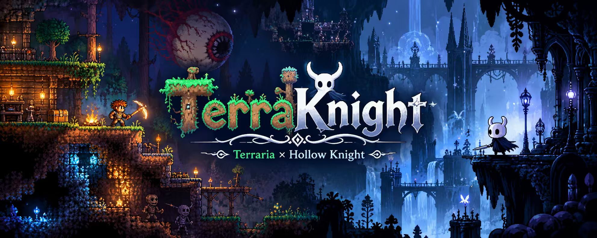

<!-- ==================== Language Switch ==================== -->

  <a href="./README.md">中文</a> | <strong>English</strong>

<!-- ==================== Project Banner ==================== -->

  

  <h1>TerraKnight</h1>

  

    <strong>Bring Terraria into Hollow Knight: mine, build, explore, and fight in Hallownest.</strong>
  

  <!-- ==================== Project Badges ==================== -->

  
  
  
  
  

<!-- ==================== Project Introduction ==================== -->

  You no longer play as the Knight, but enter Hallownest as a Terrarian adventurer: 
  mine terrain with a Copper Pickaxe, place blocks, craft equipment, and challenge bosses, 
  all while exploring Hollow Knight's world through Terraria-style progression.

<!-- ==================== Quick Links ==================== -->

  <a href="https://github.com/haoawake/TerraKnight/releases">
    <strong>Latest Release</strong>
  </a>
  &nbsp;·&nbsp;
  <a href="./docs/INSTALL.en.md">
    <strong>Installation Guide</strong>
  </a>
  &nbsp;·&nbsp;
  <a href="./docs/GAMEPLAY.en.md">
    <strong>Controls</strong>
  </a>
  &nbsp;·&nbsp;
  <a href="./docs/FEATURES.en.md">
    <strong>All Features</strong>
  </a>
  &nbsp;·&nbsp;
  <a href="https://www.bilibili.com/video/BV1H4pr6LEAM/">
    <strong>Video Demo</strong>
  </a>

---

## 📑 Table of Contents

- [✨ Highlights](#-highlights)
- [🚀 Download and Installation](#-download-and-installation)
- [🎮 Gameplay and Controls](#-gameplay-and-controls)
- [🌐 Multiplayer](#-multiplayer)
- [📰 Changelog](#-changelog)
- [📚 Guides and Reference](#-guides-and-reference)
- [❓ FAQ](#-faq)
- [🛠️ Technical Details and Development](#️-technical-details-and-development)
- [🧹 Uninstallation and Third-party Code](#-uninstallation-and-third-party-code)
- [💬 Community QQ Group](#-community-qq-group)

---

## ✨ Highlights

| System | Features |
| :--- | :--- |
| **⚔️ Terraria Progression** | Four classes, over a thousand items, weapons and accessories, original crafting recipes, ores and materials, and drops organized by progression stage. |
| **⛏️ Mining and Building** | Mine Hallownest's terrain with a pickaxe, place blocks, build platforms and workstations, and explore beyond the usual routes. |
| **👑 Combat and Bosses** | Terraria-style health, mana, equipment stats, and damage systems integrated with Hollow Knight's bosses and exploration. |
| **🎚️ Difficulties and Modes** | Normal, Difficult, Expert, and Master difficulty, plus Creative mode for testing, exploration, and demonstrations. |
| **🗺️ Exploration and Quality-of-life Features** | Bestiary, town NPCs and shops, pylon teleportation, additional save slots, equipment loadout switching, and inventory management. |
| **🤝 Multiplayer** | Direct-IP multiplayer for up to 16 players over LAN or virtual LAN, with cooperative exploration, combat, and building. |

> This is an overview of the key features. See the **[🧩 full feature documentation](docs/FEATURES.en.md)** for detailed mechanics, values, and limitations.

## 🚀 Download and Installation

### System Requirements

**Supported platform: Windows 64-bit.**

You need the Steam versions of **Hollow Knight** and **Terraria** installed on the same PC. TerraKnight reads Terraria's textures, audio, and localized resources from your local installation at runtime, so **Hollow Knight alone is not enough**.

| Requirement | Version |
| :--- | :--- |
| **Hollow Knight** | Steam stable release **1.5.12620** |
| **Terraria** | Steam **1.4.x** |
| **Mod Loader** | **BepInEx 5.4.23.x**, Windows x64 (included in the installer) |
| **Operating System** | **Windows 64-bit** |

### Quick Installation

1. Download the latest **`TerraKnight-vX.Y.Z-Setup.exe`** from [TerraKnight Releases](https://github.com/haoawake/TerraKnight/releases).
2. Close Hollow Knight, run the installer and click "安装" (Install). The installer includes the BepInEx 5 framework and finds Hollow Knight and Terraria in the Steam libraries on every drive (the two games may be on different drives).
3. Double-click **`空洞泰拉.bat`** in the game directory (or the "空洞泰拉" desktop shortcut) to launch the mod.

`TerraKnight-vX.Y.Z.zip` on the same releases page is the archive for a manual install: extract it into the Hollow Knight game directory.

> [!IMPORTANT]
> **Use a fresh save slot when possible and back up your original saves beforehand.**
>
> If the mod fails to load or you encounter version mismatches or MonoMod / Modding API conflicts, consult the full troubleshooting instructions.

**📖 [Installation steps, directory examples, and troubleshooting →](docs/INSTALL.en.md)**

## 🎮 Gameplay and Controls

Start a new adventure in King's Pass, using Terraria weapons and accessories in place of some of the Knight's original movement and combat abilities. Switch between class loadouts, mine and build, collect materials, and craft new equipment.

| Guide | Description |
| :--- | :--- |
| **[🎮 Gameplay Guide](docs/GAMEPLAY.en.md)** | Launch instructions, controls, and gameplay tips |
| **[🧩 Full Feature Reference](docs/FEATURES.en.md)** | Detailed game mechanics and complete feature descriptions |
| **[📺 Gameplay Demo](https://www.bilibili.com/video/BV1H4pr6LEAM/)** | Watch the TerraKnight demo on Bilibili |

## 🌐 Multiplayer

TerraKnight supports **direct-IP multiplayer for up to 16 players**, using port **`7777`** by default, with optional room passwords.

Each player uses their own character and save, exploring, fighting, and building together in the same scene.

> [!NOTE]
> Multiplayer still has some synchronization limitations, including certain boss mechanisms and shop behaviors. All players should use the same mod version.

**🌐 [Hosting, joining, synchronization rules, and known limitations →](docs/MULTIPLAYER.en.md)**

## 📰 Changelog

This section summarizes changes, new features, and fixes across versions. Check the [Releases page](https://github.com/haoawake/TerraKnight/releases) for the latest version and trailer.

| Version | Highlights |
| :--- | :--- |
| **2.6.1** | Complete crafting recipes are shown in the crafting panel for every class loadout. |
| **2.6.0** | Reworked progression-based drops, material crafting, and Geo distribution. |
| **2.5.x–2.4.x** | Improvements to bosses, maps, lighting, workstations, the Dream Nail, and more. |
| **2.0** | Introduced multiplayer, customizable controls, and additional save slots. |

**[📜 Full Changelog](docs/CHANGELOG.en.md)** · **[⬇️ All Releases](https://github.com/haoawake/TerraKnight/releases)**

## 📚 Guides and Reference

The following documents provide details on gameplay mechanics, progression, and balance testing.

| Document | Description |
| :--- | :--- |
| **[All Features](docs/FEATURES.en.md)** | Classes, items, world systems, combat, economy, Creative mode, and other mechanics |
| **[Stage Comparison](阶段对照.en.md)** | How Hollow Knight exploration stages correspond to Terraria progression |
| **[Enemy Encounter Order](怪物遭遇顺序.en.md)** | Enemy encounters arranged by exploration progress |
| **[Drop Records](掉落记录.md)** | Enemy drops, sources, and drop probabilities |
| **[Balance Testing Report](平衡性测试报告.en.md)** | Numerical and combat-balance test results |
| **[Changelog](docs/CHANGELOG.en.md)** | Features added and fixes made in each version |

## ❓ FAQ

<strong>Why am I still playing as the original Knight?</strong>

Make sure to launch through `空洞泰拉.bat` and check `BepInEx/LogOutput.log` for TerraKnight loading messages.

<strong>Can I still launch unmodded Hollow Knight through Steam?</strong>

Yes. The launcher temporarily enables BepInEx when launching the mod. Before you first use the launcher, a fresh BepInEx installation may still be enabled by default.

<strong>Why do I need to install Terraria?</strong>

The mod reads textures, sounds, and localized resources directly from your local Terraria installation instead of bundling those assets.

<strong>What if TerraKnight conflicts with Scarab, Lumafly, or an older Modding API?</strong>

Refer to the installation guide for troubleshooting MonoMod, Mono.Cecil, and Modding API dependency conflicts, and avoid mixing incompatible mod-loading environments.

**🔧 [Full Troubleshooting Guide →](docs/INSTALL.en.md#4-troubleshooting)**

## 🛠️ Technical Details and Development

TerraKnight uses **BepInEx** to run Hollow Knight with Terraria-style systems implemented at runtime. Terrain, collisions, resource loading, and some map processing have dedicated implementations.

### Code Directories

| Directory | Description |
| :--- | :--- |
| [`src/`](src/) | Project source code |
| [`launcher/`](launcher/) | Launcher code |
| [`tools/`](tools/) | Related tools |
| [`promo/`](promo/) | Promotional resources and tools |

**🛠️ [Implementation, requirements, configuration, and development guide →](docs/DEVELOPMENT.en.md)**

## 🧹 Uninstallation and Third-party Code

Read the uninstallation instructions before removing the mod to avoid accidentally deleting save data or files belonging to other mods. Third-party code acknowledgments and licensing information are also documented there.

**📦 [Uninstallation Instructions and Third-party Code Notices →](docs/UNINSTALL.en.md)**

## 💬 Community QQ Group

Join the TerraKnight QQ group to discuss gameplay, share your experiences, and report issues or suggestions.

  
  
Scan the QR code to join the QQ group

---

  
<strong>Author's Bilibili profile:</strong> <a href="https://space.bilibili.com/438616101">Visit the creator's page</a>

  
<strong>TerraKnight is an unofficial fan-made project and is not affiliated with Re-Logic or Team Cherry.</strong>

[⬆ Back to top](#terraknight)
